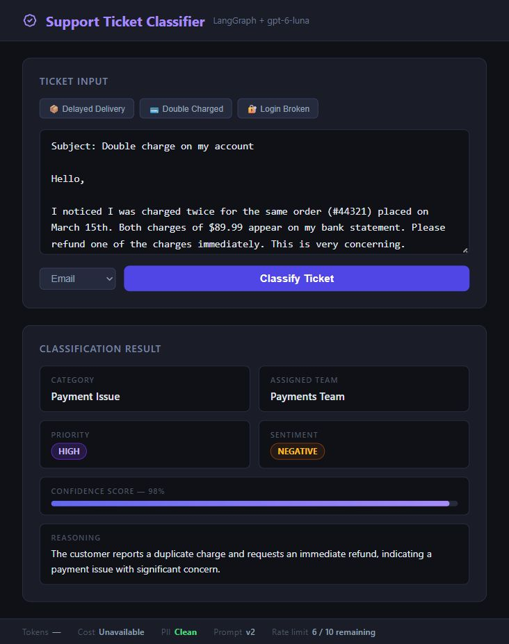
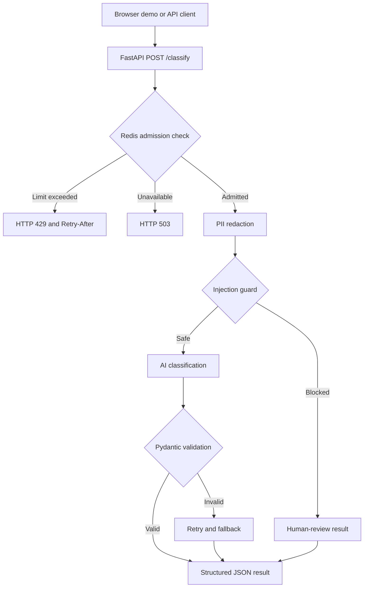

# Support Ticket Classifier

An AI support-ticket routing demo built with **FastAPI, LangGraph, Pydantic,
OpenAI, and Upstash Redis**. Submit a customer complaint and get an issue
category, owning team, priority, sentiment, confidence, and review flag.



## Features

- A browser demo served by FastAPI, with delivery, payment, and account samples.
- Structured classification with seven issue categories and five owning teams.
- Regex redaction for email addresses, phone numbers, and card-like sequences.
- An LLM injection guard that blocks flagged input and fails closed on guard outages.
- Pydantic output validation, versioned prompts, retries, and human-review fallback.
- OpenAI and Gemini provider configuration shared by the AI entry points.
- Distributed Redis admission control with expiring counters, HTTP 429, and retry headers.
- Unit tests with mocked providers and an opt-in live Redis verification script.

## Architecture



Both AI calls receive redacted text. Redis holds admission counters, not tickets.
This is a learning and demonstration application; it does not persist a ticket queue
or dispatch tickets into an external support system.

FastAPI serves the demo UI and a LangGraph ticket classification pipeline.
The pipeline redacts email, phone, and card patterns, checks injection attempts,
classifies the ticket, validates its Pydantic schema, and falls back to human review.

## Run locally on Windows

Prerequisites: Python 3.11 or newer (locally verified on 3.14), an OpenAI API key
with model access and available quota, and an Upstash Redis REST URL/write token.

```powershell
git clone https://github.com/harshgavandit/support-ticket-classifier.git
cd support-ticket-classifier
Copy-Item .env.example .env
```

Create `.env` using `.env.example`. Set `OPENAI_API_KEY`, `OPENAI_MODEL`,
`UPSTASH_REDIS_REST_URL`, and `UPSTASH_REDIS_REST_TOKEN` locally. Keep credentials private.
The configured OpenAI model is `gpt-6-luna`; access and quota depend on your project.

```powershell
python -m venv .venv
.\.venv\Scripts\python.exe -m pip install -r requirements.txt
.\run.ps1
```

Open http://127.0.0.1:8000 for the demo and http://127.0.0.1:8000/docs for API docs.
The demo uses the same origin for API requests; no separate HTML server is needed.

On macOS or Linux:

```bash
python3 -m venv .venv
.venv/bin/python -m pip install -r requirements.txt
cp .env.example .env
# Fill in the credentials in .env before starting.
.venv/bin/python -m uvicorn main:app --host 127.0.0.1 --port 8000 --no-proxy-headers
```

Environment variables override values loaded from `.env`. Restart the server
after changing provider or rate-limit configuration. `.env` is ignored by Git;
the checked-in example contains no credentials.

## Configuration

| Variable | Purpose | Default / example |
|---|---|---|
| `LLM_PROVIDER` | Active provider | `openai` |
| `OPENAI_API_KEY` | OpenAI credential | Set locally |
| `OPENAI_MODEL` | OpenAI model; overrides `DEFAULT_MODEL` | `gpt-6-luna` |
| `UPSTASH_REDIS_REST_URL` | HTTPS Redis REST endpoint | Set locally |
| `UPSTASH_REDIS_REST_TOKEN` | Redis token permitting writes and EVAL | Set locally |
| `RATE_LIMIT_ENABLED` | Enable distributed admission checks | `true` |
| `RATE_LIMIT_REQUESTS` | Requests admitted per window | `10` |
| `RATE_LIMIT_WINDOW_SECONDS` | Window duration | `60` |
| `RATE_LIMIT_PREFIX` | Redis key namespace | `support-ticket:classify` |
| `PROMPT_VERSION` | Classification prompt version | `v2` |
| `LOG_COSTS` | Log legacy cost estimates where supported | `false` in example |
| `GEMINI_API_KEY` | Optional Gemini credential | Set for Gemini |
| `DEFAULT_MODEL` | Gemini model or legacy OpenAI fallback | Provider dependent |

## API

| Method | Route | Purpose |
|---|---|---|
| `GET` | `/` | Browser demo |
| `GET` | `/health` | App configuration and liveness |
| `GET` | `/ready` | Redis connectivity; does not verify AI quota |
| `GET` | `/prompts` | Prompt versions and active version |
| `POST` | `/classify` | Rate-limited ticket classification |
| `GET` | `/docs` | Interactive OpenAPI documentation |

Example request using PowerShell:

```powershell
$body = @{
    ticket_text = 'I was charged twice for order #44321. Please refund the duplicate charge.'
    channel = 'email'
} | ConvertTo-Json
Invoke-RestMethod -Uri http://127.0.0.1:8000/classify -Method Post -ContentType 'application/json' -Body $body
```

`ticket_text` must contain 5–4,000 characters. `channel` accepts `web_form` or
`email` and defaults to `web_form`.

Example from a live OpenAI verification run; model outputs can vary:

```json
{
  "issue_category": "payment_issue",
  "assigned_team": "payments_team",
  "priority": "medium",
  "user_sentiment": "negative",
  "confidence_score": 0.98,
  "reasoning": "The customer reports a duplicate charge and requests a refund, which requires payment investigation.",
  "requires_human_review": false,
  "pii_detected": false,
  "prompt_version": "v2",
  "cost_info": null,
  "injection_blocked": false
}
```

Categories: `order_issue`, `payment_issue`, `delivery_issue`, `product_issue`,
`account_issue`, `refund_request`, and `other`. Teams: `fulfillment_team`,
`payments_team`, `logistics_team`, `customer_support`, and `tech_team`.
Confidence is model-reported, not a calibrated accuracy measurement.

## Tests and verification

```powershell
.\.venv\Scripts\python.exe -m pytest tests -q
```

Tests mock AI and Redis calls and do not require provider quota. Both classification
and the injection guard use the selected provider. `OPENAI_MODEL` takes precedence
over `DEFAULT_MODEL` for OpenAI. GPT-6 Luna uses `reasoning_effort=none` to support
the guard's Chat Completions function calls; seed is omitted for GPT-6 models.
Set `LLM_PROVIDER=gemini`, `GEMINI_API_KEY`, and a Gemini `DEFAULT_MODEL` to switch back.

Cost/token estimates are unavailable (`cost_info: null`) for Gemini and models
absent from the legacy price table, including GPT-6 Luna. The legacy estimates
for older OpenAI models omit prompts, guard calls, and retries and are not billing totals.
Provider guard outages return HTTP 503 instead of displaying a false injection result.
Both AI calls receive the redacted text; PII logs contain entity types only.

The app runs locally; public deployment requires a host and access controls.
The longer `documentation.md` and PDF describe the original OpenAI version.

## Redis rate limiting

`POST /classify` allows 10 requests per client IP per 60 seconds by default.
Configure `RATE_LIMIT_REQUESTS` and `RATE_LIMIT_WINDOW_SECONDS` in `.env` and restart.
The window begins with the first admitted request. An atomic Redis Lua script
checks the counter, increments admitted requests, and sets its expiry. Denials
do not extend the window. Counters are shared between processes and survive app restarts.
Only expiring, namespaced counters are stored; client identities are HMAC digests.
Tickets and credentials are never written into Redis counters.

Responses include `X-RateLimit-Limit`, `X-RateLimit-Remaining`, and `X-RateLimit-Reset`
(Unix seconds). Exhaustion returns HTTP 429 with `Retry-After` (seconds), before
either AI call. Redis outages or invalid responses return HTTP 503 with a short
retry delay. Invalid request bodies also consume admission attempts. A classification
request may use multiple provider calls; this is an API request limit, not a token budget.

`/`, `/health`, `/ready`, `/prompts`, and `/docs` do not consume classification limits.
`/health` reports configuration; `/ready` checks Redis connectivity. Missing Redis
credentials while limiting is enabled cause startup to fail. `RATE_LIMIT_ENABLED=false`
explicitly disables limiting for isolated development.

The provided launcher disables proxy headers, so client-supplied `X-Forwarded-For`
cannot choose a fresh identity. When deploying behind a reverse proxy, configure
trusted proxy addresses explicitly and ensure the proxy overwrites forwarding headers.
Users sharing one public IP share this limit; there is no user authentication yet.

Run the opt-in integration verification only against your configured Redis database:

```powershell
.\.venv\Scripts\python.exe scripts\verify_redis.py
```

It uses unique test prefixes with short expiries, checks concurrent admission and
window recovery, and exercises HTTP 429 with mocked AI calls. It never clears the database.

The local verification run passed **33 tests**. Live Redis checks admitted exactly
2 of 12 concurrent attempts with a test limit of 2, verified shared counters,
returned `200, 200, 429` through the API, and admitted a request after expiry.
Separate live OpenAI checks covered payment routing, delivery with PII, and injection
blocking. These are recorded demonstration checks, not throughput or production guarantees.
GitHub Actions runs unit tests without real credentials or paid AI requests.

## Project layout

```text
main.py                   FastAPI routes, lifecycle, and admission dependency
graph.py                  LangGraph orchestration
schema.py                 Classification enums and Pydantic models
production_modules/       Provider config, guard, redaction, validation, retries,
                          prompt registry, cost estimates, and Redis limiter
demo_ui/index.html        Browser interface
tests/                    Provider, API, classification, and rate-limit tests
scripts/verify_redis.py    Opt-in real Redis checks with isolated expiring keys
run.ps1                   Local Windows launcher
.env.example              Credential-free configuration template
.github/workflows/        Automated unit-test workflow
documentation.md/.pdf     Original learning notes; some details predate updates
```

## Troubleshooting and deployment limits

- **Startup rejects Redis settings:** supply both REST settings and a write-capable
  token, or explicitly disable limiting for isolated development.
- **HTTP 429:** wait for `Retry-After`; the browser shows remaining requests.
- **HTTP 503:** check Redis readiness and server logs. AI guard failures also return
  503; verify the key, model access, provider availability, and quota.
- **Successful response with zero confidence:** inspect the human-review flag;
  retries may have exhausted or the injection guard may have blocked the input.
- PII redaction uses patterns and does not cover every name, address, or phone format.
  The LLM guard is a heuristic, not a complete security boundary.
- The app has no authentication and currently allows all CORS origins. Before public
  hosting, add access controls, restrict origins, terminate TLS, and configure trusted
  proxies. Per-IP admission control is not a global spending cap.
- Dependency requirements use minimum versions rather than a reproducible lockfile.
  Validate dependency upgrades before deploying them.

## Reference documentation

- [FastAPI](https://fastapi.tiangolo.com/)
- [LangGraph](https://docs.langchain.com/oss/python/langgraph/overview)
- [OpenAI GPT-6 Luna](https://developers.openai.com/api/docs/models/gpt-6-luna)
- [Gemini OpenAI compatibility](https://ai.google.dev/gemini-api/docs/openai)
- [Upstash Redis REST API](https://upstash.com/docs/redis/features/restapi)
